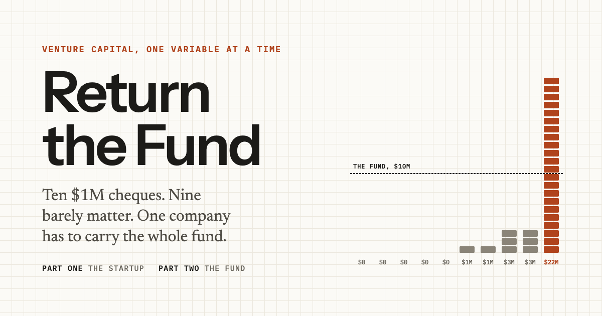

# Return the Fund

Venture capital from the bare basics, one variable at a time.

**Live:** https://return-the-fund.vercel.app (Part two: https://return-the-fund.vercel.app/#part-two)



Return the Fund is an explorable explainer in two parts. Part one puts you in an investor's seat with a $10M fund and works out what one company has to become for that fund to matter. Part two turns around and asks where a $100M fund's money comes from, what the people who put it in expect back, and how long they wait to find out. Every number on the page can be counted, and every number shows the sum that made it.

It's built on Scott Kupor's *Secrets of Sand Hill Road*, using Chain Bear's way of teaching Formula 1 strategy. It's a companion to *Half a Ship Sinks*: that piece makes you feel the risk, and this one lets you work it out.

---

## Why this exists

I knew the words that matter in venture capital: ownership, dilution, follow-ons, preferences, the one winner. I knew them the way you know tyres and pit stops matter in F1. I could nod along, but I couldn't hold them all in my head as one model. Every explanation I found threw all the variables at me at once.

Chain Bear's *Building an F1 Strategy from the Bare Basics* fixed that for F1. It starts with a race so simple you can count it, adds one thing at a time, and ends each step with a sum that turns into a rule. So the question for this project was: what if you did that for VC?

## The method

These rules held for the whole build, and every model on the page follows them.

- **One new variable per model.** If a model needed two new ideas, it got split in two.
- **Everything can be counted.** One note is $1M of money. One square is one share of a company. The charts are made of notes and squares, so you can recount any of them.
- **Show the working.** No number appears without the sum that made it, for example `$1M ÷ 10% = $10M`.
- **Numbers before jargon.** Pre-money, pro rata, carry, DPI and the rest show up as labels on things you've already built, never before.
- **Unknowns are letters.** Small chips mark what's unknown, like Chain Bear's pit-stop "P": **E** for the sale, **F** for the fund, **V** for today's value, **h** and **s** for the odds, **R** for what a fund's investments return. The same chips sit on the sliders that set them.
- **Each model ends in one short rule.**
- **F1 is the method, never the look.** No cars, tracks or chequered flags.
- **Nothing random.** No simulations or scores, and nothing is stored.

## Part one: the startup side

You have a $10M fund and write $1M cheques. One company, Orbit, is followed the whole way through.

| # | Model | The one new thing | What it shows | Rule |
|---|---|---|---|---|
| 1 | One cheque | The sale, **E** | $1M buys 10 of Orbit's 100 squares. Your take is 10% × E: zero at worst, unlimited at best. | You can lose the cheque. What you can win has no ceiling. |
| 2 | Ten cheques | A portfolio | Five fail, two give the money back, two triple. Without a winner the fund gets $8M back from $10M. The winner needs $2M to return the fund and $22M to triple it. | One company carries the fund. |
| 3 | The sale you need | The fund, **F** | Flip Model 2 round: E = F ÷ your share. $10M at 10% needs $100M. A $100M fund needs $1B, which is where "can this be a billion-dollar company?" comes from. **V**, today's value, shows the growth needed. | Fund ÷ your share = the sale you need. |
| 4 | Other investors arrive | Dilution | Alex (Series A) pays $5M for 25 new squares. Blake (Series B) pays $20M for 25 more. Your 10 squares never change, but your share falls from 10% to 8% to 6.67%, so the sale you need rises to $150M. | Divide by the share you'll have at the end. |
| 5 | Follow on, or a new bet? | The odds, **h** then **s** | $1M buys 1.25 squares in Orbit's Series B or 10 squares in Nova, a new seed company. The crossover is h = 1/8, which is just old price ÷ new price. Then Orbit's own chance of survival, s, is added. | Follow on when a new bet's odds are worse than old price ÷ new price. |
| 6 | Who gets paid first | Preferences | Investors can take their money back instead of their share. Model 6 compares what a square is worth in the sale with what each holder paid for it. Blake switches to taking a share at exactly $120M, the price Blake paid for the company. | Preferences decide the small sales. Big sales are all squares. |
| 7 | Other investors set the price | Price | A hot deal at double the price halves your squares and doubles the sale you need. In a cold market, money held back buys more than twice as many squares. | Pay double, need double. Reserves go furthest when prices fall. |

The page ends with a calculator for your own fund, share and rounds.

## Part two: the fund

Now you're the general partner (GP) of a $100M fund, raised from limited partners (LPs).

| # | Model | The one new thing | What it shows |
|---|---|---|---|
| 1 | Other people's money | LPs | LPs put in $99M and you put in $1M. With no fees, whatever the fund returns is split 99 to 1. |
| 2 | The fee | 2% a year | $2M a year for ten years is $20M, so only $80M gets invested. A toggle shows a simple step-down to 1% after year 5. |
| 3 | Carry | 20% of the profit | LPs paid in $80M invested plus $20M of fees, and all $100M comes back to them before any carry. If the fund returns $300M, your carry is $40M, so your total pay is $20M of fees plus $40M of carry. |
| 4 | What LPs need | A target | For LPs to make 3× net, the fund must return $100M + ($200M ÷ 0.8) = $350M. That means turning $80M into $350M, or one company selling for $3.5B. |
| 5 | Time | Years | Money is called as it's needed: $16M invested plus the $2M fee each year for five years, then the fee alone. It comes back late. LPs are down $90M after year 5 and only above zero in year 8. That's the J-curve. A fee strip underneath fills in every single year. |
| 6 | Carry taken too early | Clawback | Under deal-by-deal carry, an early $150M sale pays you $28M. If the rest of the fund disappoints, you owe some of it back. |
| 7 | Paper and cash | Two scores | In year 4, cash back ÷ paid in (DPI) is 0, but counting paper value (TVPI) it's 1.33×. You raise your next fund on paper, and LPs judge you on cash. |

The page ends with a fund calculator: fund size, fee, carry and target in, and out come the fees, the money invested, the return needed and the one-company sale that would deliver it, which links straight back to Part one.

## How it got here

The project took one long session between me and Claude (Claude Code). Most of what's good about it came from the review rounds, so here they are in order.

**1. Design first.** Before any code there was a written design (`docs/superpowers/specs/`). It set the intent, the ladder of models with every number checked in Python, and the anti-goals: no F1 visuals, no jargon before numbers, no chart you can't recount.

**2. First build.** Vite, React and TypeScript, with every sum in pure functions written test-first. Money and shares were both drawn as squares.

**3. "The models need to be more explicit in the numbers."** My first review. What price did the Series A and B investors pay? Why does the formula read one way on top and the other way in the model? In the ten-company model, why does the chart show "??" when the number returned is right there? That led to the biggest rule of the build: **every number shows its working.** Prices per square appear in every round, and equations read in the same order as the story.

**4. Pointed comments, model by model.** I opened the page as a claude.ai artifact and left comments directly on it. Here's what changed as a result:
- **Money and shares looked the same.** Money became $1M *notes*, twice as wide as the squares, so you can't mistake one for the other.
- **Sliders didn't show which letter they set.** The letter chips (E, F, h, s) moved onto the sliders.
- **Break-even was hard to read.** It got clearer, and Model 3's $1M cheque now follows the fund size.
- **Model 6 was hard to follow.** It was rebuilt around one comparison, what a square is worth versus what you paid, with each holder's squares and money counted out.
- **Nobody could remember who was who.** The players got names: **Alex** (Series A), **Blake** (Series B), **Orbit** (the company) and **Nova** (the new bet). **V** became today's value, and Blake's switch at $120M is explained, not just shown.

**5. The voice took three tries.**
- The first draft was a first-person learner's diary, which felt too personal ("too obvious it's AI").
- The rewrite as a plain textbook was correct but cold ("there's no love in the content, I can't post this on Twitter").
- The final voice is a warm guide talking to *you*: "let's", a little wit, short paragraphs. The rules were cut to one short line each, and the book callouts were trimmed to a single credit per part.
- "The napkin sum" was renamed "the sale you need" because "napkin" sounded off. A test now fails if "napkin" or "block" ever appears on the page.

**6. Part two, on its own branch.** The fund side lives on `#part-two` of the same page, so it ships in one bundle and needs no server config. It was built on a separate branch so Part one could be shared while Part two was still in progress.

**7. "Carry doesn't have fees built in, there's no talk about yearly fees and GP clawback."** This was a correction to the model itself, not just the copy:
- Fees now go inside the carry sum, so LPs get back everything they paid in, fees included, before carry starts.
- Fees are shown year by year, with an optional step-down.
- A new model covers carry taken too early, and the clawback that follows.

The follow-up "Time model needs a fee takeout part as well, cause that's every year irrespective" added the fee strip under the J-curve. The money calls were redone as $16M invested plus $2M of fee each year, which moved the whole curve. Every number was re-verified in Python.

**8. Ideas I parked.** We talked about a bigger-fund model, a Fund I → II → III model, and a model of the fundraise itself. I decided to let it be. Two parts is the story.

**9. Content review.** A final read of both parts against their own numbers. One real clash: a "$150M sale in year 6" didn't match the Model 5 fund. It's now a separate example. A few overclaims came out ("a coin flip", "a common step-down"). Every figure in the text was checked against its model.

**10. Code review.** A separate reviewer read Part two cold. The fixes:
- A false subtraction shown below $100M.
- Calculator lines that didn't follow from their own rounded numbers. They now chain, with a test that checks 240 settings.
- A scroll side effect in the wrong place.

## Decisions Claude made

These weren't discussed; they're Claude's calls, written down so they can be revisited.

- **Stack:** Vite 7, React 19, TypeScript, CSS modules, Vitest and Testing Library, plus Vercel Analytics. It's a static site.
- **Look:** a graph-paper notebook. Warm off-white paper, a faint grid, Newsreader for prose, IBM Plex Mono for numbers, Instrument Sans for labels. Each player keeps one colour everywhere: you (rust), founders (warm grey), Alex and LPs (blue), Blake (green).
- **Maths:** all of it lives in pure, tested functions in `src/model/`, and the components only draw what those return. Every number in the design docs is pinned by a test.
- **Deal terms:** preferences are 1× and non-participating, and all investors stand equal in line. That's a simplification, and the page says so.
- **Routing:** `#part-two` is a hash, not a path, so the same build works on Vercel and inside a claude.ai artifact.
- **Phones:** every model is checked at 375px with no sideways scroll.

## Run it

```bash
npm install
npm run dev      # http://localhost:5173 (Part two at /#part-two)
npm test         # every number on the page is pinned by a test
npm run build    # static site in dist/
```

`npx vite build --mode artifact` builds a copy without Vercel Analytics, for packing into a single HTML file.

## Deploy

On Vercel, import the repo and choose the Vite framework preset. No other settings are needed. Link previews build absolute URLs from `VERCEL_PROJECT_PRODUCTION_URL` automatically. Anywhere else, set `VITE_SITE_URL` to the site's origin.

## Where things live

```
src/model/     the maths, pure and tested (company, portfolio, follow-on, waterfall, fund)
src/ui/        notes and squares, equations with letter chips, sliders, sections
src/models/    Part one, one component per model
src/part2/     Part two, one component per model
docs/superpowers/specs/   the two designs, including the revision after review
docs/superpowers/plans/   the two build plans
public/og-image.png       the link preview (1200 × 630)
```

## If you're building on this

- Keep the method: one new variable per model, and every number shows its working.
- Write the maths first, as a pure function with a test, and only then draw it.
- Never write "block" or "napkin" on the page; tests enforce both. Money is notes, shares are squares.
- Keep the voice warm, second person and short. Each rule is one line.
- Credit Kupor once per part, plus the source list. Use F1 for the method only.
- Check new work at 375px wide.

## Sources

- Scott Kupor, *Secrets of Sand Hill Road* (2019): the deal shapes and fund terms, simplified.
- Chain Bear, *Building an F1 Strategy from the Bare Basics*: the method.
